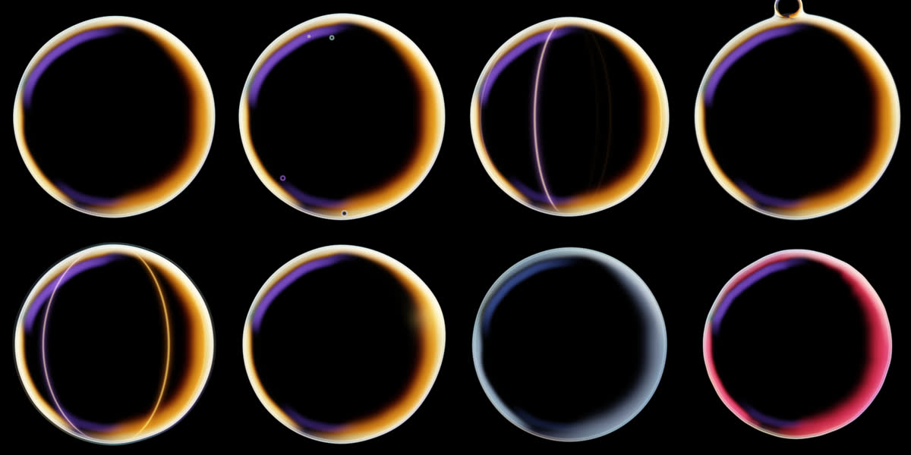

# Thinking orb

An iridescent soap-bubble status orb for an AI chat bot, modelled on the four clips in `../Thinking orb ref`. It is a single WebGL fragment shader in `orb.js` (~14 KB, no dependencies). Open `index.html` and use the buttons, or append `?state=thinking` to the URL.



The bubble is drawn in 2D, not raymarched, so each pixel costs one pass. A deformable outline gives the silhouette. The back wall's warm crescent, the violet streak and the front wall's cyan film band are layered by depth from the edge. The canvas only redraws while it is on screen.

## States

The states come from how shipping assistants signal status. Amazon's Echo light ring separates **listening**, **thinking** and **speaking**, and the speaking pulse tracks the loudness of the voice. Agent chat UIs add separate states for reasoning, tool calls, streamed text and errors. They also add a state where the bot is waiting on the user, so a single "loading" spinner never hides what is going on.

| State | When to use it | Motion (ref clip) |
|---|---|---|
| `idle` | Ready, nothing in flight | Slow breathing, almost still |
| `listening` | User is typing or speaking | Grows slightly; small dents drift over the film (`0e18…`). `orb.setLevel()` drives it from mic or keystroke rate |
| `thinking` | Reasoning before the first token | Folds sweep in as vertical streaks, open into rings and fade, on a ~5 s cycle (`008d…`) |
| `researching` | Web search, reading sources | The rim layers, then a droplet buds off, slides around the edge and merges back (`f4c6…`) |
| `working` | Tool calls, editing files, running code | Folds turn fast and the rim splits into offset layers |
| `typing` | Streaming the answer | One side swells in a speech-like rhythm (`1074…`). `setLevel()` can drive it from TTS volume |
| `waiting` | Needs approval or input from the user | Smaller, cooler and dimmer, with a slow pulse |
| `error` | A request or tool failed | Shrinks, shivers and turns red |
| `success` (one-shot) | A task just finished | Springy pop and flash, then it returns to the current state |

Skip states the product cannot detect. Without voice input, `listening` can mean "user is typing". Without tools, `working` and `researching` can merge into `thinking`.

## Embedding

```html
<canvas id="avatar" style="width:40px;height:40px"></canvas>
<script src="orb.js"></script>
<script>
  const orb = ThinkingOrb.create(document.getElementById('avatar'));
  orb.setState('thinking');   // any key in ThinkingOrb.states
  orb.trigger('success');     // one-shot pop
  orb.setLevel(0.7);          // 0..1 mic / TTS / typing level; null = built-in simulation
  orb.destroy();              // stop and free the WebGL context
</script>
```

The canvas has a transparent, premultiplied background, so the orb works on any dark surface. `prefers-reduced-motion` slows every state down. Each orb uses its own WebGL context, and browsers allow about 16 at once, so give each chat its own orb rather than each message.

Sources: [Alexa light ring guidelines](https://developer.amazon.com/alexa/branding/echo-guidelines/identity-guidelines/light-ring), [AI chat UX patterns](https://www.metacto.com/blogs/ai-chat-ux-patterns-production), [Building agent interfaces](https://cdn.jsdelivr.net/npm/@mindstudio-ai/remy@0.1.202/dist/prompt/compiled/agent-interfaces.md).
